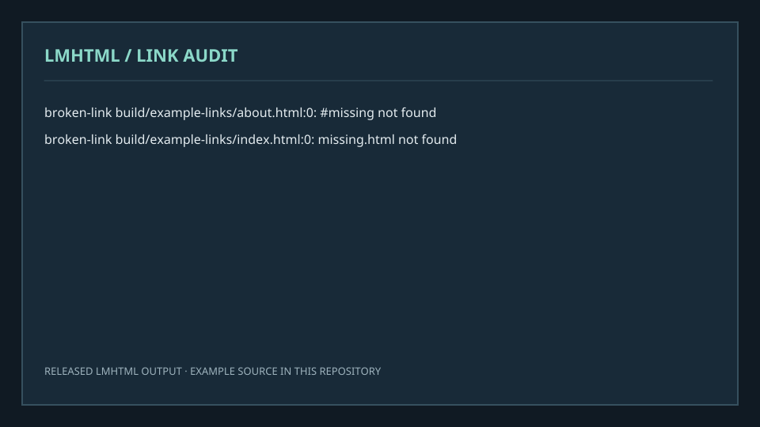
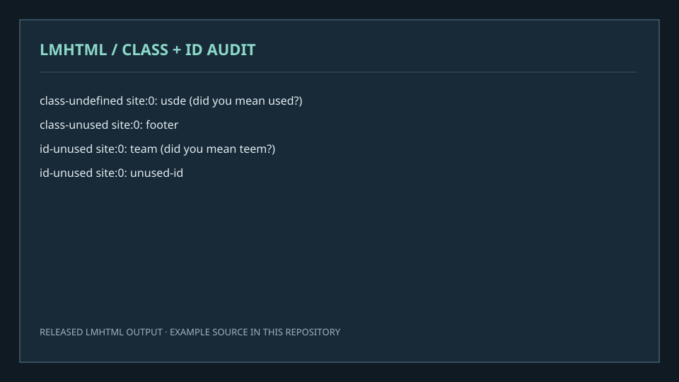
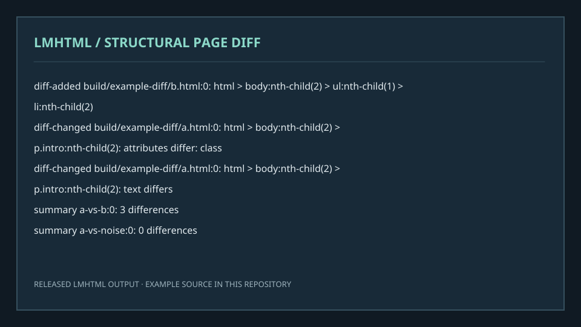
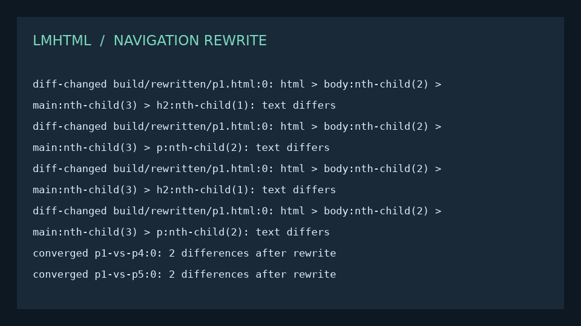
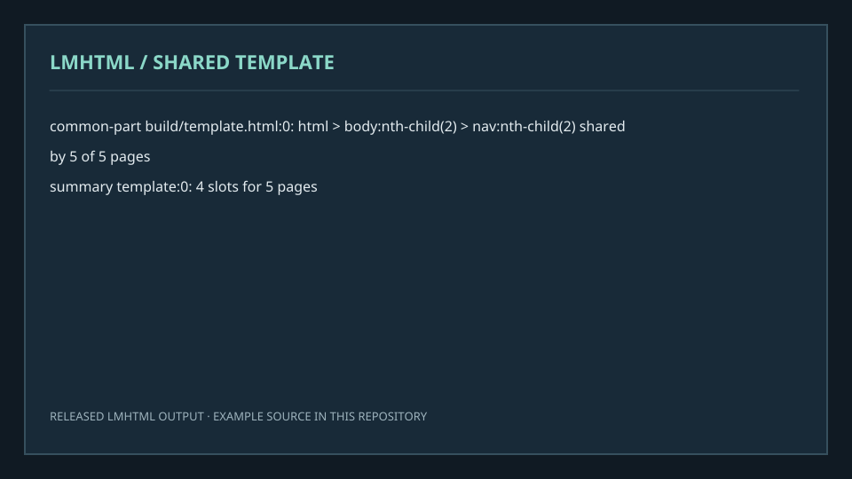
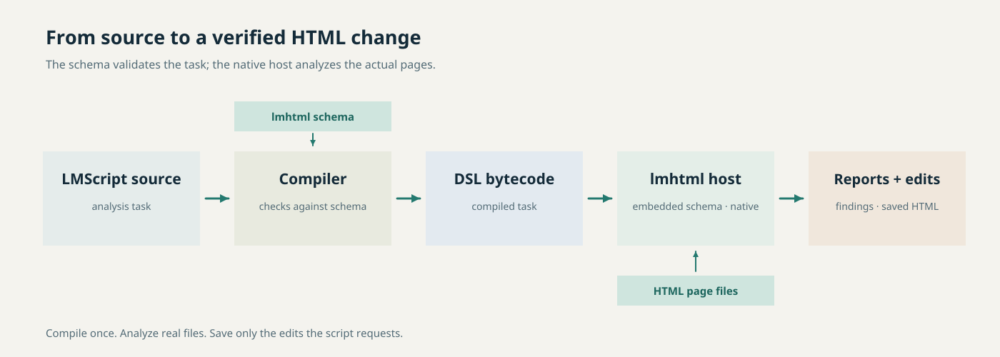

<p align="center">
  <picture>
    <source media="(prefers-color-scheme: dark)" srcset="docs/readme/hero-dark.png">
    <source media="(prefers-color-scheme: light)" srcset="docs/readme/hero-light.png">
    
  </picture>
</p>

**lmhtml finds broken links, structural differences and shared markup in HTML sites, then helps you make verified edits.**

[](https://github.com/lmctl-ai/lmhtml/releases)
[](https://github.com/lmctl-ai/lmhtml/actions/workflows/ci.yml)
[](LICENSE)

## See what lmhtml does

| Link audit | CSS class and ID audit |
| --- | --- |
|  |  |
| Finds missing pages and anchors. [Source](examples/check-links.lms) · [example book](https://lmctl.com/tools/lmhtml/examples/check-links.html) | Finds near misses and unused names. [Source](examples/class-typos.lms) · [example book](https://lmctl.com/tools/lmhtml/examples/class-typos.html) |

| Structural diff | Shared navigation rewrite |
| --- | --- |
|  |  |
| Separates real page changes from formatting noise. [Source](examples/diff-pages.lms) · [example book](https://lmctl.com/tools/lmhtml/examples/diff-pages.html) | Applies a common navigation update, then checks convergence. [Source](examples/rewrite-nav.lms) · [example book](https://lmctl.com/tools/lmhtml/examples/rewrite-nav.html) |

| Shared template extraction |
| --- |
|  |
| Finds repeated page structure and writes template slots. [Source](examples/make-template.lms) · [example book](https://lmctl.com/tools/lmhtml/examples/make-template.html) |

## How it works

This diagram is rendered by lmdraw from [architecture-light.lms](docs/readme/architecture-light.lms) and [architecture-dark.lms](docs/readme/architecture-dark.lms). It shows the real compiler, schema, bytecode, host and page-file flow.

<p align="center">
  <picture>
    <source media="(prefers-color-scheme: dark)" srcset="docs/readme/architecture-dark.png">
    <source media="(prefers-color-scheme: light)" srcset="docs/readme/architecture-light.png">
    
  </picture>
</p>

## Quick start

```sh
npm install -g @lmctl-ai/lmctl
lmctl init
lmctl autorun lmhtml_solo
```

For a team review, run `lmctl autorun lmhtml_trio` instead; both names resolve to the published solo and trio scripts. The [get started guide](https://lmctl.com/tools/lmhtml/get_started.html) explains provider setup and the [release page](https://github.com/lmctl-ai/lmhtml/releases) has native binaries. Custom tool scripts need lmscript 0.2.369 or newer; declare cli="lmhtml" and install="github:lmctl-ai/lmhtml@latest" on the _dsl_ line so lmscript fetches the host schema automatically.

## Learn and download

- [lmhtml book](https://lmctl.com/tools/lmhtml/) · [get started](https://lmctl.com/tools/lmhtml/get_started.html) · [API guide](https://lmctl.com/tools/lmhtml/guide.html)
- [LMScript DSL](https://lmctl.com/tools/lmscript/skill.html) · [DSL schema](schema/lmhtml.dsl.json) · [releases](https://github.com/lmctl-ai/lmhtml/releases)

## Regenerate the README artwork

Run `docs/readme/render.sh` to execute the five examples with the released lmhtml host, render the hero and architecture pictures with lmdraw, and refresh the gallery cards from the actual reports. The lmscript sources live in `docs/readme/`.

## License and company

lmhtml-authored code is MIT licensed; see [LICENSE](LICENSE) and [THIRD_PARTY_NOTICES](THIRD_PARTY_NOTICES) for third-party terms.

Made by **Lattice Systems LLC**.
